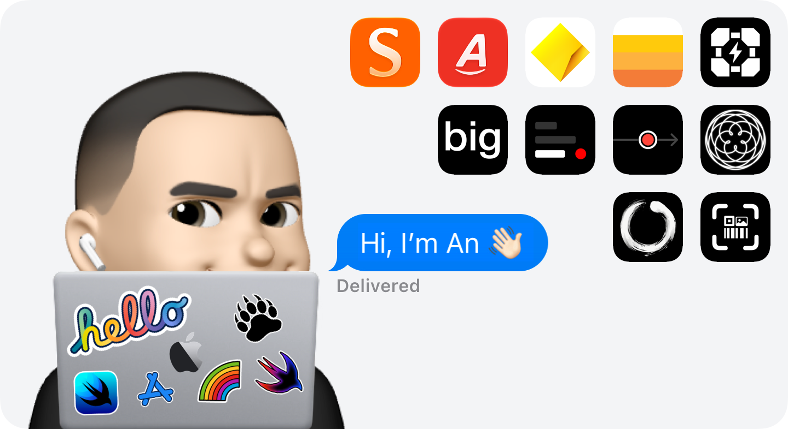
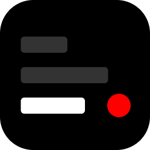
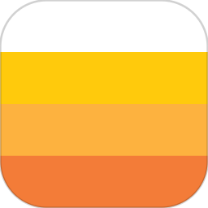
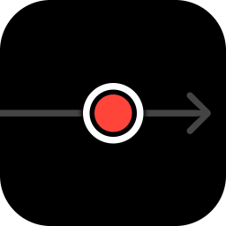
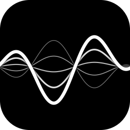
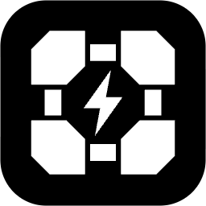
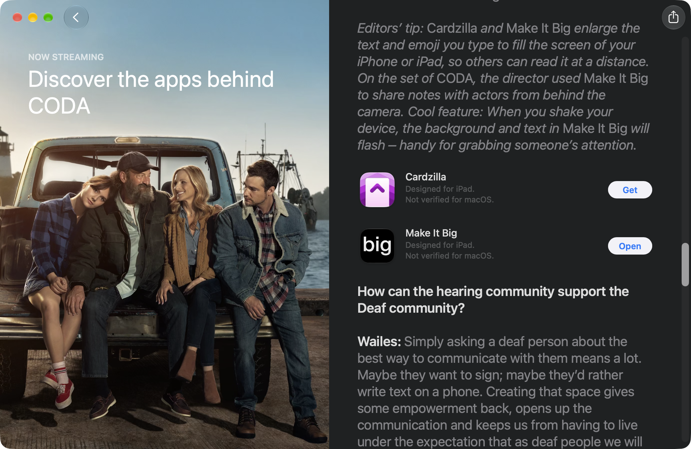
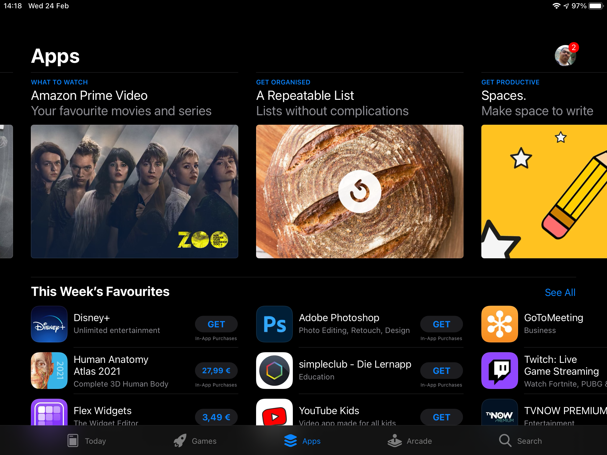

<b>iOS engineer, 15+ years, Swift &amp; SwiftUI</b>

Focused on building apps people love and writing modern, maintainable and well-tested code.

&nbsp;

&nbsp;

# 🌳 Work

Large-scale consumer iOS apps I've worked on.

Current | Previous | Previous
--|--|--
 <a href="https://apps.apple.com/gb/app/sainsburys/id1086056964">Sainsbury's</a> |  <a href="https://apps.apple.com/gb/app/argos-shop-tech-toys-more/id370371087">Argos</a> |  <a href="https://apps.apple.com/au/app/commbank/id310251202">CommBank</a>

# 🪴 Personal apps

Apps I've built and published to the App Store. [Make It Big](#make-it-big) is my flagship and is still actively developed; the rest are projects where I explored a specific Apple technology end-to-end.

&nbsp;

&nbsp;

&nbsp;

&nbsp;

&nbsp;

&nbsp;

&nbsp;

&nbsp;

## Make It Big

 

Show large text on your screen.

> Over 2 million downloads, native iOS and iPadOS app built with Swift and SwiftUI, WidgetKit Home Screen and Lock Screen widgets, App Intents for Siri Shortcuts and Control Centre, App Groups for widget data sharing, share extension, custom URL-scheme deep linking, localisation in 52 locales, VoiceOver and Dynamic Type accessibility support

🤩 Featured by  Apple in 41 Countries, May 2022

😍 Mentioned in the App Store Story: [Discover the Apps Behind CODA](https://apps.apple.com/gb/story/id1582547591), February 2022

🤩 Featured by  Apple in 23 Countries, February 2014 - June 2014

 

## A Repeatable List

 

Create a list, complete it, repeat it.

> SwiftUI, App Clip, Lock Screen Widgets, Home Screen Widgets, Drag & drop support, Dark mode support, Voiceover & Dynamic Text support, Localised to 32 languages, Taptic feedback

🤩 Featured by  Apple in Japan, September 2022

🤩 Featured by  Apple in 8 Countries, February 2021

&nbsp;&nbsp;&nbsp;&nbsp;&nbsp;

&nbsp;&nbsp;&nbsp;&nbsp;&nbsp;

 

## Pong AR

 

Play Pong with your face!

> SwiftUI, ARKit, SpriteKit, GameKit (Game Center leaderboard), Taptic feedback

&nbsp;&nbsp;&nbsp;&nbsp;&nbsp;

 

## Point in time

 

Track a single point in time.

> SwiftUI, ActivityKit (Dynamic island, Live activities), BackgroundTasks, CoreMotion, WidgetKit (Lock screen and Home screen widgets)

&nbsp;&nbsp;&nbsp;&nbsp;&nbsp;

 

## Code Scanner

 

Scans for codes using your camera, or from an image in your photos.

> SwiftUI, Vision Framework, AVFoundation, Taptic feedback, Action Extension (scan codes from Image share sheet)

&nbsp;&nbsp;&nbsp;&nbsp;&nbsp;

 

## Zen AF

 

Minimalist Pomodoro Timer.

> SwiftUI, Taptic feedback, AirPlay (AVKit)

&nbsp;&nbsp;&nbsp;&nbsp;&nbsp;

 

## Speech to Image

> ℹ️ Removed until a suitable image API is found (previous one is no longer maintained).

A conversation visualiser. Converts your speech to images, providing context to conversations.

> Swift Playgrounds 4 app, SwiftUI, Speech API (Speech Recognition), Natural Language API (to identify adjectives/nouns), Async/Await

&nbsp;&nbsp;&nbsp;&nbsp;&nbsp;

 

## UK COVID-19 Statistics

 

Track the latest coronavirus (COVID-19) daily new cases and deaths in the UK.

> Open source, Swift Charts, SwiftUI, Async/Await, Widget, Background task to fetch periodically, local notifications

&nbsp;&nbsp;&nbsp;&nbsp;&nbsp;

 

## Battery Level - Portal

 

Monitor the current battery level of your device. As you charge your device, the battery level will be announced.

> Dark mode support, Custom App Icons, Taptic feedback, Siri Shortcuts

&nbsp;&nbsp;&nbsp;&nbsp;&nbsp;

 

## Spiro

  

An interactive animating spirograph generator.

> Swift Playgrounds 4 app, Open source, SwiftUI

&nbsp;&nbsp;&nbsp;&nbsp;&nbsp;

 

## SF Symbols Browser

SwiftUI app to search and showcase SF Symbols. 🔎

> Open source, SwiftUI, (enum style values, searchable modifier, dismiss environment variable, text selection, multiple sheet presentation, foundation pluraliser)

&nbsp;&nbsp;&nbsp;&nbsp;&nbsp;

 

## buttoncraft

SwiftUI app to allow other developers craft that perfect SwiftUI button effect. 👌🏼

> Open source, SwiftUI

&nbsp;&nbsp;&nbsp;&nbsp;&nbsp;

 

# 🌱 Open source projects & experiments

Small, focused projects I've shared to help others learn SwiftUI, ordered by GitHub stars.

| Project | What it is | ⭐&nbsp;Stars |
|--|--|--|
| **[buttoncraft](https://github.com/atrinh0/buttoncraft)** | Design a SwiftUI button style visually, randomise for inspiration, then copy the generated `ButtonStyle` code. | ⭐&nbsp;447 |
| **[SF Symbols Browser](https://github.com/atrinh0/sfsymbols)** | Search, sort and showcase SF Symbols. A tour of `.searchable`, text selection, multiple sheet presentation and more. | ⭐&nbsp;135 |
| **[wwdc22](https://github.com/atrinh0/wwdc22)** | The WWDC22 artwork recreated in SwiftUI. | ⭐&nbsp;88 |
| **[appleid-animation](https://github.com/atrinh0/appleid-animation)** | The animation on appleid.apple.com recreated in SwiftUI. | ⭐&nbsp;62 |
| **[spiro](https://github.com/atrinh0/spiro)** | Animated spirograph generator, created on iPad as a Swift Playgrounds 4 app and [published to the App Store](https://apps.apple.com/app/id1602980337). | ⭐&nbsp;58 |
| **[covid19](https://github.com/atrinh0/covid19)** | UK COVID-19 statistics app with Swift Charts, a widget, background refresh and local notifications. | ⭐&nbsp;43 |
| **[chart-de-lune](https://github.com/atrinh0/chart-de-lune)** | Composing music with Swift Charts and VoiceOver audio graph descriptors: a chart that plays Debussy's *Clair de Lune*. | ⭐&nbsp;42 |
| **[SciFiChallenge](https://github.com/atrinh0/SciFiChallenge)** | A Star Trek LCARS-inspired UI built with SwiftUI, Swift Charts, WeatherKit and Grid. | ⭐&nbsp;31 |

